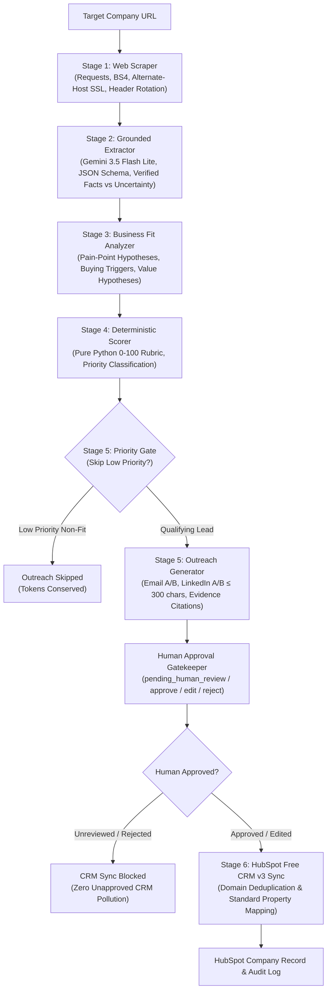

# AI Lead-Research and Outreach Copilot

[](https://www.python.org/downloads/)
[](https://aistudio.google.com)
[](https://streamlit.io)
[](https://developers.hubspot.com)
[](LICENSE)

An open-source, **human-in-the-loop AI sales intelligence system** for B2B lead qualification, account research, and personalized multi-channel outreach generation.

Built around a simulated Ideal Customer Profile (ICP) for **SalesFlow CRM** (a cloud B2B CRM tailored for growing Indian SMBs managing distribution networks and field sales teams), the copilot automates website intelligence extraction, analyzes CRM product fit, computes transparent deterministic scores, generates anti-fluff outreach drafts across Email and LinkedIn, enforces strict human approval gates, and synchronizes approved leads to **HubSpot Free CRM v3**.

---

## 🎯 Core Technical Principles

1. **Strict Evidence Grounding:** Inferred operational bottlenecks are explicitly classified as `hypothesis`, while verified company details require direct textual citations from public web sources.
2. **Deterministic ICP Scoring:** Lead scoring is computed via a pure Python weighted rubric (0–100 scale), eliminating LLM numerical drift and non-deterministic rating variances.
3. **Anti-Fluff Copywriting:** Banned generic AI cliches ("*I hope this email finds you well*", "*in today's fast-paced world*"). Hooks cite verified triggers (depot expansion, sales hiring). LinkedIn connection notes are hard-capped at $\le 300$ characters.
4. **Mandatory Human-in-the-Loop Gate:** All generated drafts initialize to `pending_human_review`. Automated outbound email or LinkedIn dispatch is strictly unsupported. Unapproved leads are blocked from CRM synchronization.
5. **Token-Preserving Skip Safeguard:** Disqualified low-priority non-fits (e.g. enterprise scale giants like Stripe or Shopify) bypass outreach generation entirely, conserving LLM token consumption.

---

## 🏗️ System Architecture



---

## 📁 Repository Structure

```
ai-lead-research-copilot/
├── .venv/                      # Python virtual environment
├── requirements.txt            # Project dependencies (requests, bs4, google-genai, streamlit, pandas)
├── README.md                   # Technical documentation and architecture guide
├── EVALUATION.md               # Empirical benchmark report across 22 companies
├── .gitignore                  # Security exclusions (.env, local JSON outputs)
├── .env.example                # Environment variable template (GEMINI_API_KEY, HUBSPOT_ACCESS_TOKEN)
│
├── app.py                      # Interactive terminal CLI pipeline (Stages 1–6)
├── dashboard.py                # Multi-view Streamlit web application (Stages 1–6 + Benchmark Analytics)
├── evaluate_copilot.py         # Empirical benchmark harness
│
├── test_scraper.py             # Automated test suite for Stage 1 (Scraper & SSL fallback)
├── test_extractor.py           # Automated test suite for Stage 2 (Extractor & grounding)
├── test_analyzer.py            # Automated test suite for Stage 3 (Analyzer & triggers)
├── test_scorer.py              # Automated test suite for Stage 4 (Deterministic scorer)
├── test_outreach.py            # Automated test suite for Stage 5 (Outreach & char limits)
├── test_crm_sync.py            # Automated test suite for Stage 6 (Human gate & HubSpot sync)
├── test_evaluate.py            # Automated test suite for evaluation helpers
│
├── research/                   # Core business logic
│   ├── __init__.py             # Clean module exports
│   ├── scraper.py              # Stage 1: Requests & BeautifulSoup clean text extractor
│   ├── extractor.py            # Stage 2: Grounded company profile extractor (Gemini)
│   ├── analyzer.py             # Stage 3: CRM relevance, pain points & buying triggers (Gemini)
│   ├── scorer.py               # Stage 4: Deterministic 0–100 ICP scoring engine (Pure Python)
│   ├── outreach.py             # Stage 5: Grounded 4-variant sales messaging engine (Gemini)
│   ├── crm_sync.py             # Stage 6: Human approval gate & HubSpot Free CRM v3 integration
│   └── evaluation.py           # Evaluation helper utilities (taxonomy, review protocol)
│
└── data/                       # Evaluation datasets, templates, and audit logs
    ├── evaluation_leads.csv    # Curated 22-lead benchmark dataset
    ├── evaluation_results.csv  # Empirical per-lead benchmark output
    ├── evaluation_summary.json # Aggregated benchmark metrics
    └── sample_target_companies.csv # Batch evaluation CSV template
```

---

## 📊 Empirical Benchmark Results

The system was benchmarked against an empirical dataset of **22 companies** (`data/evaluation_leads.csv`), encompassing Indian food processors, FMCG distributors, electrical manufacturers, B2B SaaS platforms, enterprise non-fits, and intentional failure controls.

| Metric | Measured Benchmark Value | Technical Significance |
| :--- | :--- | :--- |
| **Total Companies Evaluated** | **22** | Realistic mix of ICP targets, enterprises, and controls |
| **Scrape Success Rate** | **68.2% (15 / 22)** | Successfully extracted clean text from 15 websites |
| **Scraping Failure Taxonomy** | 3 HTTP errors, 1 DNS fail, 1 SSL expired, 1 JS SPA, 1 timeout | Clean technical classification without pipeline crashes |
| **Score Distribution** | **1 High / 8 Medium / 7 Low / 6 Unscored** | Differentiated scoring across ICP tiers |
| **Enterprise False Positives** | **0% (0 / 4 enterprises)** | Stripe, Shopify, Zoho, Salesforce downranked to Low |
| **Token-Saving Outreach Skips** | **6 leads (27.3%)** | Preserved tokens on disqualified non-fits |
| **Outreach LLM Success Rate** | **10 Success / 0 Fallbacks** | 100% grounded copy generation on qualifying leads |
| **Average Copilot Time / Lead** | **6.63 seconds** (~0.11 minutes) | Measured wall-clock execution time |
| **Assumed Manual SDR Baseline** | 15.0 minutes / lead | Industry standard research and drafting time |
| **Average Time Saved / Lead** | **14.89 minutes (99.3% reduction)** | Prep time reduction per researched account |

*Full evaluation methodology, per-lead breakdowns, and failure categorizations are documented in [EVALUATION.md](file:///c:/Users/PC/Downloads/pros/ai-lead-research-copilot/EVALUATION.md).*

---

## 🚀 Getting Started

### 1. Prerequisites
* Python 3.11+
* Git
* Windows PowerShell (or macOS/Linux bash)
* Google Gemini API Key ([Google AI Studio](https://aistudio.google.com))
* HubSpot Private App Access Token *(Optional: built-in simulated dry-run mode active if omitted)*

### 2. Installation

```powershell
# Clone the repository
git clone https://github.com/Sooraj055/ai-lead-research-copilot.git
cd ai-lead-research-copilot

# Create and activate virtual environment
python -m venv .venv
.\.venv\Scripts\Activate.ps1

# Install dependencies
pip install -r requirements.txt
```

### 3. Environment Configuration
Create a `.env` file in the project root:
```ini
GEMINI_API_KEY="your_actual_gemini_api_key_here"
HUBSPOT_ACCESS_TOKEN="your_hubspot_private_app_token_here"  # Optional
```

---

## 🖥️ Usage

### 1. Interactive Streamlit Web Application
```powershell
.\.venv\Scripts\python.exe -m streamlit run dashboard.py
```
Open `http://localhost:8501` to access:
* **View 1: Single Lead Deep Dive:** Enter any URL or load the built-in demo lead to inspect the 4 structured tabs (Profile, CRM Intelligence, 0–100 Score Card, and Outreach & Human Approval Gate).
* **View 2: Batch CSV Evaluation:** Upload a multi-company CSV to run batch research with live progress and CSV export.
* **View 3: CRM Sync Audit Log:** Inspect all synced, edited, and simulated HubSpot transactions.
* **View 4: Evaluation Benchmark:** Review the live 22-company empirical benchmark metrics and scrape failure taxonomy directly inside the dashboard.

### 2. Interactive Terminal CLI
```powershell
.\.venv\Scripts\python.exe app.py
```

### 3. Run Benchmark Harness
```powershell
.\.venv\Scripts\python.exe evaluate_copilot.py
```

---

## 🧪 Automated Test Suite

Run the automated test suites to verify each module independently:

```powershell
# 1. Scraper Test Suite (HTTP headers, SSL alternate-host, error handling):
.\.venv\Scripts\python.exe test_scraper.py

# 2. Extractor Test Suite (Gemini grounding, verified facts vs uncertainty):
.\.venv\Scripts\python.exe test_extractor.py

# 3. Business Analyzer Test Suite (CRM relevance, buying triggers, pain points):
.\.venv\Scripts\python.exe test_analyzer.py

# 4. Deterministic Scorer Test Suite (Pure Python 0-100 rubric, weights):
.\.venv\Scripts\python.exe test_scorer.py

# 5. Outreach Generator Test Suite (4 variants, <= 300 char LinkedIn note, token skips):
.\.venv\Scripts\python.exe test_outreach.py

# 6. Human Approval & CRM Sync Test Suite (Gatekeeper, dry-run & live HubSpot v3):
.\.venv\Scripts\python.exe test_crm_sync.py

# 7. Evaluation Harness Helper Test Suite (Failure taxonomy, report generation):
.\.venv\Scripts\python.exe test_evaluate.py
```

---

## 🛡️ Governance, Safety & Security

* **Mandatory Human-in-the-Loop:** Outreach drafts default to `pending_human_review`. The system contains no automated outbound email or LinkedIn API sending capabilities.
* **Gatekeeper CRM Protection:** Unreviewed or rejected leads cannot be synced to HubSpot CRM.
* **Secret Protection:** `.env` is strictly excluded via `.gitignore`. The system operates cleanly in dry-run mode when credentials are not configured.
* **Domain Deduplication:** Searches HubSpot by company domain prior to record creation, preventing duplicate company entries.
* **Schema Resilience:** Custom research summaries and scores are formatted into HubSpot's standard `description` property, ensuring compatibility with standard HubSpot Free accounts without requiring paid custom properties.

---

## 📄 License
This project is open-source under the [MIT License](LICENSE).
