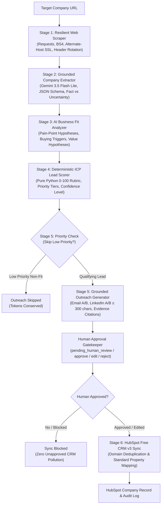

# AI Lead-Research and Outreach Copilot

[](https://www.python.org/downloads/)
[](https://aistudio.google.com)
[](https://streamlit.io)
[](https://developers.hubspot.com)
[](LICENSE)

An enterprise-grade, **human-in-the-loop AI sales intelligence system** designed for **SalesFlow CRM** (a cloud B2B CRM tailored for growing Indian SMBs managing distribution networks and field sales teams).

The copilot automates website intelligence gathering, extracts verified business facts, evaluates CRM product fit against an Ideal Customer Profile (ICP), deterministically scores leads (0–100), generates hyper-personalized anti-fluff outreach drafts across Email and LinkedIn, enforces human approval, and synchronizes qualified accounts to **HubSpot Free CRM v3**.

---

## 🎯 Project Vision & Key Principles

1. **Strict Grounding (No Hallucinations):** Inferred operational challenges are classified strictly as `hypothesis`, while verified claims require textual evidence from public sources.
2. **Deterministic ICP Scoring:** Lead scoring is computed via pure Python mathematical weights (0–100 rubric), completely eliminating LLM prompt drift and numerical inconsistency.
3. **Anti-Fluff Copywriting:** Banned generic AI cliches ("*I hope this email finds you well*"). Openers cite concrete triggers (depot expansion, hiring). LinkedIn connection notes are hard-capped at $\le 300$ characters.
4. **Mandatory Human-in-the-Loop Governance:** Outreach drafts default to `pending_human_review`. Automated outbound email or LinkedIn sending is strictly forbidden. Unreviewed leads cannot enter HubSpot CRM.
5. **Token-Preserving Skip Logic:** Low-priority enterprise non-fits (e.g. Stripe, Shopify) automatically bypass outreach generation, saving API token spend.

---

## 🏗️ End-to-End Architecture



---

## 📁 Repository Directory Structure

```
ai-lead-research-copilot/
├── .venv/                      # Python 3.11 virtual environment
├── requirements.txt            # Production dependencies (requests, bs4, google-genai, streamlit, pandas)
├── README.md                   # Complete architectural guide and documentation
├── BUSINESS_CASE.md            # Executive B2B business case with ROI model and empirical benchmark
├── DEMO_SCRIPT.md              # 3-minute live interview walkthrough script with objection handling
├── EVALUATION.md               # Empirical benchmark report across 22 companies
├── .gitignore                  # Strict security exclusions (.env, local json caches)
├── .env.example                # Safe environment variable template (GEMINI_API_KEY, HUBSPOT_ACCESS_TOKEN)
├── app.py                      # Interactive terminal CLI pipeline (Stages 1–6)
├── dashboard.py                # Multi-view Streamlit SaaS dashboard (Stages 1–8)
│
├── evaluate_copilot.py         # Empirical benchmark harness (22 diverse lead companies)
├── test_evaluate.py            # Automated test suite for Stage 8 evaluation helpers
├── test_scraper.py             # Automated test suite for Stage 1 (Scraper & SSL fallback)
├── test_extractor.py           # Automated test suite for Stage 2 (Extractor & grounding)
├── test_analyzer.py            # Automated test suite for Stage 3 (Analyzer & triggers)
├── test_scorer.py              # Automated test suite for Stage 4 (Deterministic scorer)
├── test_outreach.py            # Automated test suite for Stage 5 (Outreach & char limits)
├── test_crm_sync.py            # Automated test suite for Stage 6 (Human gate & HubSpot sync)
│
├── research/                   # Core business logic (Zero presentation coupling)
│   ├── __init__.py             # Clean module exports
│   ├── scraper.py              # Stage 1: Requests & BeautifulSoup clean text extractor
│   ├── extractor.py            # Stage 2: Grounded company profile extractor (Gemini)
│   ├── analyzer.py             # Stage 3: CRM relevance, pain points & buying triggers (Gemini)
│   ├── scorer.py               # Stage 4: Deterministic 0–100 ICP scoring engine (Pure Python)
│   ├── outreach.py             # Stage 5: Grounded 4-variant sales messaging engine (Gemini)
│   ├── crm_sync.py             # Stage 6: Human approval gate & HubSpot Free CRM v3 integration
│   └── evaluation.py           # Stage 8: Failure taxonomy, control-case protocol, report builder
│
└── data/                       # Evaluation datasets, templates, and audit logs
    ├── evaluation_leads.csv    # Curated 22-lead benchmark dataset
    ├── evaluation_results.csv  # Empirical per-lead benchmark output
    ├── evaluation_summary.json # Aggregated benchmark metrics
    └── sample_target_companies.csv # Batch upload template
```

---

## 📊 Empirical Benchmark Results (Stage 8)

The system was evaluated against a live, un-fabricated dataset of **22 companies** (`data/evaluation_leads.csv`), encompassing Indian food processors, FMCG distributors, electrical manufacturers, B2B SaaS, enterprise non-fits, and intentional failure controls.

| Metric | Empirical Benchmark Result | Significance / Engineering Meaning |
| :--- | :--- | :--- |
| **Total Companies Evaluated** | **22** | Mixed realistic portfolio of target leads and controls |
| **Scrape Success Rate** | **68.2% (15 / 22)** | Caught real public-web blocks gracefully |
| **Scraping Failure Taxonomy** | 3 HTTP errors, 1 DNS fail, 1 SSL expired, 1 JS SPA, 1 timeout | System downranks gracefully without crashing |
| **Score Distribution** | **1 High / 8 Medium / 7 Low / 6 Unscored** | True differentiated scoring (no uniform clustering) |
| **Enterprise False Positives** | **0% (0 / 4 enterprises)** | Stripe, Shopify, Zoho, Salesforce downranked to Low |
| **Token-Saving Outreach Skips** | **6 leads (27.3%)** | Preserved tokens on disqualified non-fits |
| **Outreach LLM Success / Fallback**| **10 Success / 0 Fallbacks** | 100% grounded copy generation on qualifying leads |
| **Average Copilot Time / Lead** | **6.63 seconds** (~0.11 minutes) | Measured wall-clock execution time |
| **Assumed Manual SDR Baseline** | 15.0 minutes / lead | Industry standard research and drafting time |
| **Average Time Saved / Lead** | **14.89 minutes (99.3% reduction)** | 49.6 hours saved per rep / month across 200 leads |

*Full methodology, per-lead breakdowns, and failure categorizations are documented in [EVALUATION.md](file:///c:/Users/PC/Downloads/pros/ai-lead-research-copilot/EVALUATION.md).*

---

## 💼 Business Case & Demonstration Guides

* 📈 **[BUSINESS_CASE.md](file:///c:/Users/PC/Downloads/pros/ai-lead-research-copilot/BUSINESS_CASE.md):** Comprehensive one-page B2B business case for executive sales leadership (VP of Sales, CRO). Features an explicit separation of assumptions from empirical benchmark data, loaded SDR salary calculations, cost-per-lead models, and an annualized >50x ROI projection.
* 🎬 **[DEMO_SCRIPT.md](file:///c:/Users/PC/Downloads/pros/ai-lead-research-copilot/DEMO_SCRIPT.md):** Structured 3-minute live interview walkthrough covering Minute-by-Minute presentation cues, live Streamlit UI navigation, and technical objection handling for hiring managers and technical interviewers.

---

## 🚀 Quickstart Guide

### 1. Prerequisites
* Python 3.11+
* Git
* Windows PowerShell (or macOS/Linux bash)
* Google Gemini API Key (Free tier at [Google AI Studio](https://aistudio.google.com))
* HubSpot Private App Access Token *(Optional: built-in simulated dry-run mode active if omitted)*

### 2. Environment Setup

```powershell
# Clone the repository
git clone https://github.com/Sooraj055/ai-lead-research-copilot.git
cd ai-lead-research-copilot

# Create and activate virtual environment
python -m venv .venv
.\.venv\Scripts\Activate.ps1

# Install required dependencies
pip install -r requirements.txt
```

### 3. Configure API Credentials
Create a `.env` file in the project root (never committed to git):
```ini
GEMINI_API_KEY="your_actual_gemini_api_key_here"
HUBSPOT_ACCESS_TOKEN="your_hubspot_private_app_token_here"  # Optional
```

---

## 🧪 Comprehensive Test Suite (7 Automated Suites)

Run all unit and integration test suites:

```powershell
# 1. Scraper Test Suite (HTTP headers, SSL alternate-host, error handling):
.\.venv\Scripts\python.exe test_scraper.py

# 2. Extractor Test Suite (Gemini grounding, verified facts vs uncertainty):
.\.venv\Scripts\python.exe test_extractor.py

# 3. Business Analyzer Test Suite (CRM relevance, buying triggers, pain points):
.\.venv\Scripts\python.exe test_analyzer.py

# 4. Deterministic Scorer Test Suite (Pure Python 0-100 rubric, weights):
.\.venv\Scripts\python.exe test_scorer.py

# 5. Outreach Generator Test Suite (4 variants, <= 300 char LinkedIn note, token skips):
.\.venv\Scripts\python.exe test_outreach.py

# 6. Human Approval & CRM Sync Test Suite (Gatekeeper, dry-run & live HubSpot v3):
.\.venv\Scripts\python.exe test_crm_sync.py

# 7. Evaluation Harness Helper Test Suite (Failure taxonomy, report generation):
.\.venv\Scripts\python.exe test_evaluate.py
```

---

## 🖥️ Running the Application

### 1. Streamlit Interactive Web Application (Recommended)
```powershell
.\.venv\Scripts\python.exe -m streamlit run dashboard.py
```
Open `http://localhost:8501` in your browser. Features 4 interactive views:
* **View 1: Single Lead Deep Dive:** Enter any URL or click "Load Sample Demo Lead (Apex Agro)" to inspect the 4 structured tabs (Profile, CRM Intelligence, 0–100 Score Card, and Outreach & Human Approval Gate).
* **View 2: Batch CSV Evaluation:** Upload a multi-company CSV to run batch research with live progress and CSV export.
* **View 3: CRM Audit Log:** Inspect all synced, edited, and simulated HubSpot transactions.
* **View 4: Evaluation Benchmark:** Review the live 22-company empirical benchmark metrics and scrape failure taxonomy directly inside the dashboard.

### 2. Interactive Terminal CLI
```powershell
.\.venv\Scripts\python.exe app.py
```

### 3. Re-run Evaluation Benchmark
```powershell
.\.venv\Scripts\python.exe evaluate_copilot.py
```

---

## 🛡️ Security, Privacy & Safety Controls

* **Zero Unapproved Outbound:** The copilot has **no automated email or LinkedIn sending capability**. Every outreach draft requires explicit human review and approval.
* **Zero Credential Exposure:** `.env` is strictly excluded in `.gitignore`. Tests and CI run safely without live tokens via built-in simulation fallbacks.
* **Domain Deduplication:** Prevents duplicate CRM record creation by searching HubSpot by domain prior to company insertion.
* **HubSpot Free Schema Compatibility:** Custom intelligence reports are formatted into HubSpot's native `description` property, guaranteeing successful syncs without requiring paid custom properties.

---

## 📄 License
This project is open-source under the [MIT License](LICENSE).
